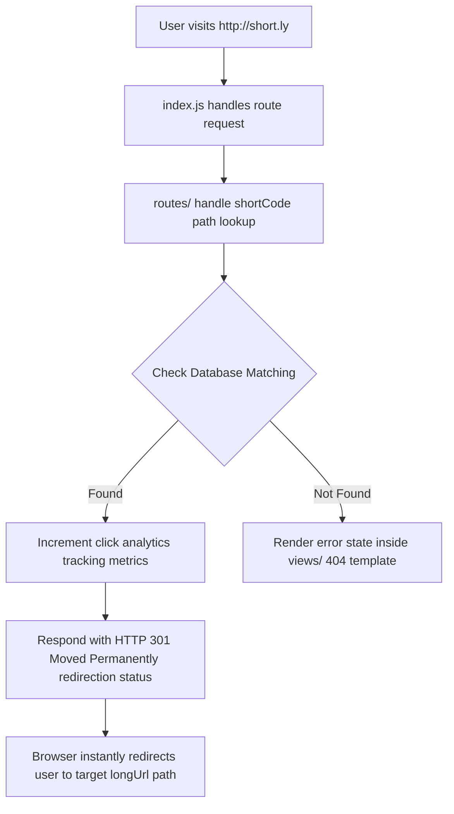

# URL Shortener

A high-performance, structured URL shortener service built with Node.js and Express to convert long, cumbersome URLs into clean, compact, and shareable links.

## 📁 Repository Architecture

This project follows an organized, enterprise-ready MVC/Service layout:
*   `controllers/` - Handles incoming API requests and manages route payloads.
*   `middlewares/` - Intercepts requests for authentication, validation, or rate-limiting.
*   `models/` - Declares schemas and defines persistence models for the link database.
*   `routes/` - Maps incoming URL paths to their respective core logical controller handlers.
*   `services/` - Houses isolated business operations (e.g., hash generation, custom code validation).
*   `views/` - Stores templates or server-side pages for short link redirect landing states.
*   `connection.js` - Sets up and exports database connectivity profiles.
*   `index.js` - The main entry point initializing the Express server application engine.

---

## 🔄 Project Flow & Architecture

The system uses standard-compliant charts to handle requests.

### 1. Shortening Flow (Request Lifecycle)
sequenceDiagram
    autonumber
    actor User as "Client App / Browser"
    participant Middleware as "Middlewares (Rate Limiter)"
    participant Routes as "Routes Router"
    participant Ctrl as "Controllers Engine"
    database Cache as "Redis Cache"
    database DB as "Database Engine"

    User->>Middleware: POST /api/shorten
    alt Rate Limit Exceeded
        Middleware-->>User: Return "429 Too Many Requests"
    else Under Limit Threshold
        Middleware->>Routes: Forward Request
        Routes->>Ctrl: Execute shortener controller
        
        Ctrl->>DB: Check custom alias collision / Save record
        DB-->>Ctrl: Write success
        
        Ctrl->>Cache: Cache link mapping (TTL: 24h)
        Cache-->>Ctrl: Cache set confirmation
        
        Ctrl-->>User: Return "201 Created" { shortUrl: "http://short.ly" }
    end


### 2. Redirection Strategy (Visiting a Short Link)
This flow shows lookup processes optimizing quick browser redirection.



---

## 🛠️ Getting Started

### 1. Installation

Clone your repository locally and install the mandatory npm packages managed in your `package.json`:

```bash
npm install
```

### 2. Configuration

Create an environment configuration file named `.env` in the root folder directory path:

```env
PORT=3000
DB_URI=mongodb://localhost:27017/url_shortener
BASE_URL=http://localhost:3000/
```

### 3. Execution

Launch the backend framework engine service locally:

```bash
# Start standard execution engine
npm start

# Run in development mode (if nodemon is configured)
npm run dev
```

---

## 🔌 API Documentation Reference

### Generate Shortcuts
*   **Endpoint:** `POST /api/shorten`
*   **Payload Layout Format:**
    ```json
    {
      "longUrl": "https://github.com"
    }
    ```
*   **Success Status:** `201 Created`

### Direct Forward Lookup
*   **Endpoint:** `GET /:shortCode`
*   **Action Output:** Automatically returns an **HTTP 301 Redirect** response header pointing to the destination server web address.
